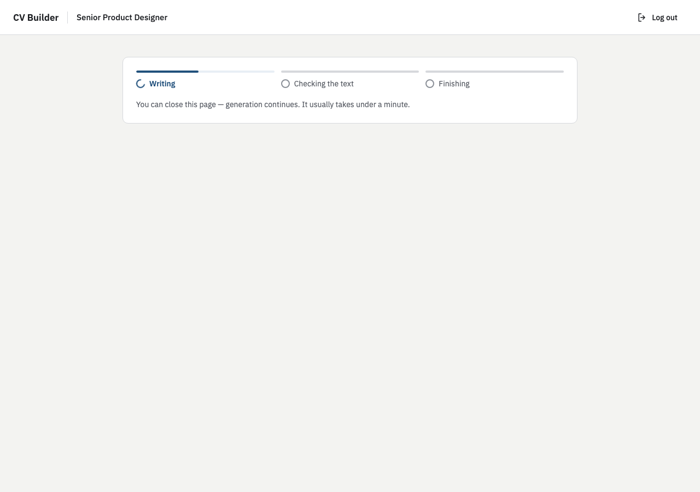
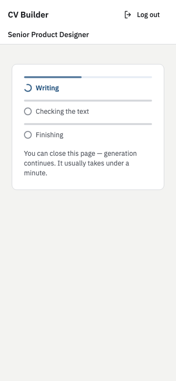

# AI CV Builder

Turns a PDF or pasted text and a target role into a structured, editable CV and an A4 PDF with selectable text. English and Ukrainian; the CV keeps the language of the source. An author model writes the CV and cites the source lines behind each item, a reviewer model checks it against the source, and code keeps the contacts exact and lists whatever the CV leaves out. Faithfulness is measured by evals, not proven by code.


## Run it

You need Docker with Compose and an Anthropic API key.

```sh
cp .env.example .env          # then set ANTHROPIC_API_KEY in .env
docker compose up --build     # http://localhost:8080
```

The first build takes a few minutes (the API image installs Chromium); migrations run on startup. Sign up with any email and a password of 8+ characters; `examples/` has invented sample CVs to paste or upload. From a phone on the same network open `http://<your-ip>:8080` (the session cookie is `Secure` only with `COOKIE_SECURE=true`).

## Run the tests

Node 24 (`.nvmrc`) and pnpm 12 (`corepack enable`), from a fresh clone:

```sh
pnpm install --frozen-lockfile
pnpm playwright:install                                   # Chromium for the PDF and template tests, once
ANTHROPIC_API_KEY=test-placeholder docker compose up -d postgres   # the tests use a cv_test database in it
pnpm check                                                # build, lint, typecheck and every test
```

If you change `POSTGRES_PORT`, set `DB_PORT` to the same value for the tests. No test calls Anthropic: the API tests replace the LLM transport with a scripted fake, so retries, the call budget and re-asks run the real code. API tests report how to start a missing Postgres; PDF and template tests need the Chromium above. The requirements and failure cases mapped to tests: [`docs/verification.md`](docs/verification.md).

## Architecture

A React SPA behind nginx (one origin, `/api` proxied) talks to a NestJS API on Fastify with PostgreSQL. Generation is a background job in a Postgres table, claimed under a lease with fencing, so a reload or a restart does not lose it; the browser polls its steps. A CV is one versioned JSON document (a stale save gets 409); sessions are server-side; every CV route checks the owner; errors are `problem+json`. The preview and the PDF render the same React template in Chromium. Details and the decisions behind them: [`docs/architecture.md`](docs/architecture.md), [`docs/DECISIONS.md`](docs/DECISIONS.md).

## How the AI is kept from inventing facts

Code checks only what is mechanical; a model judges meaning; the rest becomes a question.

- The source is split into numbered segments. Lines that match nine instruction patterns (mostly English) are cut before any model sees them; the rest is passed as data inside tags.
- The author cites segments for every item and may keep source text as it is; schemas reject anything else. Email, phone and links are kept only when they appear in the source.
- The reviewer reads the whole CV against the source and fixes or removes what is not supported; a removed item becomes a question.
- Every source line is either used or shown in "Not in your CV". Whether a rewritten item keeps every fact of its line is the reviewer's job, measured and not guaranteed.

## Failures and untrusted input

LLM answers pass zod schemas, with one re-ask and a call budget per run; a transient API error is retried, then the job is re-queued and finally fails with a message and a Retry button. A generation, a text answer and a retry each spend one unit of a daily limit (30 per user, 300 in all, configurable); a dates answer is free. Uploads are checked (magic bytes, size, pages, a worker thread with limits); scanned, encrypted and broken PDFs get a clear message. Concurrent edits, edits during a job, lost connections and a foreign CV id each have a defined behaviour, and a render error shows a message, not an empty screen. The table of cases with their tests: [`docs/verification.md`](docs/verification.md).

## Evals

On 11 dev CVs, 5 free texts, and two holdouts (6 and 4 inputs, mostly real CVs), the author/reviewer pipeline beat the earlier fact-by-fact one in a blind pairwise comparison (dev 9 wins, 0 losses, 2 splits; free text 5 of 5). The reviewer flagged 76 of 76 planted inventions, with 4 false alarms over 131 clean items. Median 24 s and $0.10 per generation. The holdouts found five defects, all fixed. Models, trade-offs and how to rerun: [`docs/evals.md`](docs/evals.md).

## What I simplified and what is next

- Deliberate deviation: the experience is newest first; an older job rises only when clearly more relevant, with a reason shown to the person, and less relevant jobs are shortened. It is a prompt policy, not a guarantee.
- No OCR, two-column PDF layouts at most, one template, a Postgres queue inside the API process, polling.
- Known silent cuts: a long direct answer, questions past the cap of 10, provenance ids past 60.
- With more time: request timeouts and retry controls in the web app, a per-route throttle for retry and answer, scrubbing exception messages in logs, recycling a wedged Chromium, renaming `factIds` and the `facts` column, untangling `llm` from `generation`, an enforced completeness check, streaming sections to the screen. The full list: [`docs/architecture.md`](docs/architecture.md#what-was-simplified-and-what-would-come-next).

## How I used AI tools

<!-- owner's text -->

## Screenshots

|           | Desktop                                                                     | Phone (360 px)                                                  |
| --------- | --------------------------------------------------------------------------- | --------------------------------------------------------------- |
| Progress  |          |  |
| Questions |  |        |
| Editor    |                      |              |
| The PDF   |                        |                |

Drawn from invented examples in `examples/`.
